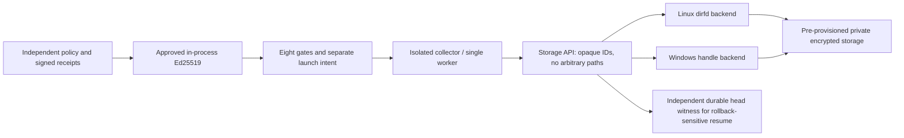

# Native security architecture decision v1

Decision scope: independent review of PR #18 at
`be5827af4345f44e6083ed3b7c84692a7772f113`, dependent on PR #17
`355e07d9bb20200df953628d49f20368d6439e54`. Engineering baseline remains
`9ed55709add0fc45f63847a0394315863faa0876`; scientific parent #15 is
`1c6fc01edef58cc1565a7c233c7a23722a4d72a1`; collector #16 is
`aa6d171d82961aa297808c24ac602076abf47883`.

Recommended target: **SRC-01 B, audited in-process Ed25519; SRC-02 C combined
with A/B, an isolated collector using platform-specific object-confined storage**.
Until implementation and independent validation, retain SRC-01 D and PR #18's
unconditional production storage denial. Architecture readiness is not native
validation, remediation closure, execution consent or scientific effectiveness.

## Protected boundary and acceptance criteria

Protect receipt authenticity, independent roles, private responses/token IDs,
immutable inventory/rubrics, complete slot accounting and bounded side effects.
Defend against an actor able to replace a specific pathname/ancestor or supply
hostile receipt/response bytes, without trusting those names as object identity.
The reviewed Python process, approved runtime image, OS kernel and deployment
authority remain trusted. An actor who can alter that trust base or control both
the independent policy and its pin is outside these mechanisms' protection.

Non-negotiable criteria: no execution through mutable verifier paths; no private
I/O escaping an approved object capability; authenticated run/operation binding;
immutable artifacts; explicit durability and recovery guarantees; evidence for
each supported OS/filesystem; fail closed on unsupported conditions. Ease of coding
does not satisfy any of those requirements. No existing check(root) callback is
accepted as a native storage implementation.

## Decision matrix

Ratings compare intended designs, not measured security scores or certifications.

| Alternative | Security / trust base | Portability | Auditability / reproducibility | Complexity / operation | Dependencies / baseline compatibility |
| --- | --- | --- | --- | --- | --- |
| SRC-01 A object-bound native executable | Must also bind loader, DLL/DSO closure and deployment | Separate Windows/Linux implementations | Large native launch surface; OS/build-specific evidence | High; lifecycle/handle/loader management | New launcher/native integration likely; retain denial now |
| SRC-01 B in-process Ed25519 **selected target** | Removes receipt-time external executable lookup; runtime image still trusted | Common API, distinct audited wheels | Exact artifact hashes and SBOM; deterministic verification corpus | Moderate; smaller protocol and process surface | Requires specific dependency/profile approval; no locks changed here |
| SRC-01 C isolated verifier | Can separate privilege domains; adds peer/IPC trust | OS-specific local channels or approved network transport | Extra service identity/version/authentication evidence | High; availability, response freshness and key lifecycle | New service/deployment authorization; disproportionate for present boundary |
| SRC-01 D production denial **selected current state** | Prevents this execution path entirely | Current Windows/Linux code | Direct denial tests; fully reproducible | Low; cannot collect a production pilot | No dependency change; compatible with PILOT_BLOCKED |
| SRC-02 A Linux descriptor I/O | Kernel-constrained lookup under a held root; trusted ownership still required | Linux only; supported local filesystem/kernel | Syscall/errno/fault evidence, namespace and mount inventory | High; every read/write/link/recovery must participate | Native interface needed; current pathname store insufficient |
| SRC-02 B Windows handle I/O | Root/child handles, file IDs, reparse policy and ACL boundary | Windows only; validated NTFS/builds initially | Native error/file-ID/security-descriptor evidence | High; ABI, share, rename, crash behavior | Audited native wrapper; no implementation adopted here |
| SRC-02 C isolated collector **selected with A/B** | Restricts who can modify deployment/storage; not a path-race fix alone | OS-specific identity/egress policy | Provisioning/permission receipts plus A/B conformance tests | Moderate additional operations; single worker | External provisioning approval; no service or protocol expansion |
| SRC-02 D storage service | Separates I/O authority; service still needs A/B internally | Common wire schema, native server deployment | More authentication, transaction and service SBOM evidence | Highest; replay, quotas, recovery, identity and uptime | New deployment/key governance; reserve for expanded threat model |

B is selected for SRC-01 because it eliminates a specific mutable-executable
boundary rather than trying to prove the external loader closure on two systems.
C plus A/B is selected for storage because ownership/isolation and object-relative
I/O address different threats. A service does not inherently solve traversal,
rollback or durability, and adds another authorization surface. If the threat model
later includes compromise of the collector process itself, reassess a separate
storage broker instead of claiming the in-process backend can contain that process.

This is a target diagram, not an installed service or active code path.

## Prototype decision and implementation order

No native backend prototype is introduced. The selected verifier requires a new
approved application dependency/profile: cryptography/PyNaCl are absent from the
maintained Windows environment and no corresponding declarations were found in
the existing requirements tree. Ubuntu WSL has a distro cryptography package, but
Python 3.14.4 and missing pytest/numpy/pandas/sklearn do not constitute the approved
hashed Python 3.12 research environment. That package is not promoted into the
application trust base. Nothing was installed, downloaded or re-pinned.

The user permits specification/validation planning when implementation needs
dependencies, binaries or privileges. This review therefore adds only documents,
synthetic review tests and evidence. Native support remains NOT_AUDITED; WSL
capability inventory is not a backend test or Linux scientific reproduction.

Implementation order: approve the crypto/runtime supply-chain proposal; implement
and independently test B without changing authorization semantics; define the
complete opaque storage API; implement A and B storage adapters separately; validate
C deployment controls; test crash/rollback/recovery; repeat independent review.
The first integration must keep production disabled until every required platform
test and deployment receipt exists. See the two decision documents and
NATIVE_VALIDATION_PLAN.md for contracts, pass criteria and stop conditions.
