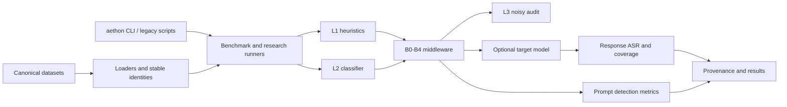

# Architecture and compatibility

AETHON is a research workbench. Its operational boundary is the repository plus
an editable Python environment and hydrated canonical datasets. New code enters
through `src/aethon/`; established scientific modules remain at their original
import and file paths so CLI users, pickles and implementation hashes survive.

| Area | Responsibility |
| --- | --- |
| `src/aethon/` | Installable command namespace and explicit dispatch to existing runners |
| `src/aethon_heuristic.py` | L1 heuristic reference |
| `src/aethon_ml_pipeline.py`, calibrated cascade modules | L2 models and independent research variants |
| `src/aethon_full_pipeline.py`, `src/benchmark/middleware.py` | Decision and L3 noisy audit behavior |
| `src/benchmark/` | Configuration, prompt detection, response ASR, execution and outputs |
| `src/loaders/`, `src/dataset_loader.py` | Canonical data normalization and identity |
| `src/models/`, `src/model_registry.py` | Lazily imported API/Hugging Face drivers and historical trusted detector artifacts |
| `src/baselines/`, `src/research_*.py` | Baselines, grouped selection, integrity, DP and paired evaluation |
| `configs/`, `docs/*PROTOCOL*` | Versioned experimental specifications; no empty experiments layer |
| `datasets/` | Canonical inputs plus source documentation; backups remain local |
| `results/revision/`, `docs/research_2026_evidence/` | Immutable historical outputs and curated evidence |
| `tests/`, `scripts/`, `.github/` | Regression, maintenance, publication and CI controls |
| `docs/archive/` | Superseded inventory/planning documents, retained as historical evidence |

B0 bypasses defenses, B1 uses L1, B2 uses L2, B3 uses the established combined
decision and B4 adds noisy audit without changing B3 decisions. See the exact
implementation and protocol for thresholds. New calibrated/margin research
variants are not silently promoted into historical B3.

The Python package is an additive compatibility migration. Moving all legacy
code at once would alter `__file__`-relative dataset/model paths, implementation
fingerprints, dynamic imports and serialized module references. Those moves are
deferred until a separately versioned research migration can validate them.
Wheels contain code, not canonical datasets or historical model binaries; current
reproduction commands require an editable checkout and repository-root cwd.

| Existing command | Equivalent installed command |
| --- | --- |
| `python src/run_benchmark.py ...` | `aethon benchmark ...` |
| `python src/run_detection_benchmark.py ...` | `aethon detect ...` |
| `python src/train_detector.py ...` | `aethon train ...` |
| `python src/research_integrity.py ...` | `aethon integrity ...` |
| `python src/research_generalization.py ...` | `aethon generalization ...` |
| `python src/research_baseline.py ...` | `aethon baseline ...` |
| `python src/research_dp.py ...` | `aethon dp ...` |

`python -m aethon` exposes the same interface. Dispatch forwards all runner flags
unchanged and imports the selected runner only when invoked.
