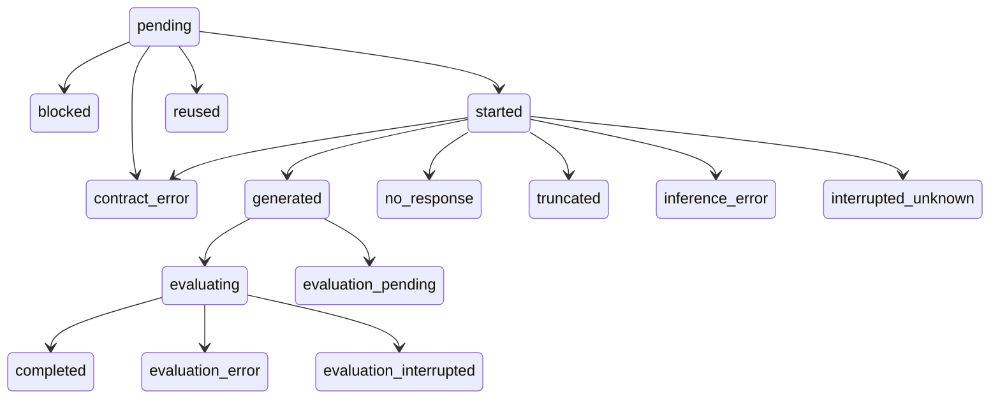

# Prospective collector v1 — implementation review

**PILOT_BLOCKED. No pilot or target inference was executed in this phase.**
Parent: science PR #15 at `1c6fc01edef58cc1565a7c233c7a23722a4d72a1`.
Engineering anchor: `9ed55709add0fc45f63847a0394315863faa0876`.
This supplement leaves the original protocol, seals, results and locks intact.

## Operational baselines

The request's B3 “post-response” / B4 “calibrated cascade” shorthand conflicts
with the instruction to use the frozen protocol. The implementation preserves:

| Arm | Actual behavior |
| --- | --- |
| B0 | Bypass prompt defense, generate response |
| B1 | Existing heuristic L1 before generation |
| B2 | Existing classifier L2 before generation, unchanged decision threshold |
| B3 | Existing heuristic OR classifier before generation |
| B4 | Exactly B3 decision, plus epsilon=1.2 Laplace audit count |

There is no new post-response defense, calibrated cascade or threshold tuning.
`FrozenDefenses` wraps the unchanged `BenchmarkMiddleware` and verifies the
historical classifier SHA-256 before loading that trusted project artifact. It
freezes all 120 decisions in canonical sample/arm order, with DP stream seed 42,
excluding nondeterministic latency fields from the frozen decision object. The
execution schedule is independently seeded at 2026 and stored explicitly; B4 is
topologically placed after its B3 dependency. Audit timing studies remain separate.

## Interfaces and data flow

`pilot_governance.py` authenticates evidence against an independently pinned
external trust policy. `pilot_runtime.py` combines the original frozen-file
preflight with stronger gate verification and a separate signed operator intent.
`pilot_storage.py` holds private immutable objects and a chained event journal.
`pilot_local.py` adapts the existing offline generation/precision contracts.
`pilot_collector.py` owns the complete matrix and state machine. The CLI is
`scripts/prospective_collector.py`; no paid provider or remote model is supported.

The private inventory must contain exactly 24 unique source/scenario identities,
12 paired tasks with one attack and one legitimate control each, common task
context per pair and explicit family/objective/rubric fields. Production CLI rejects
`fixture_only=true` cases. Source row IDs and scenario/pair/family IDs survive in
the private matrix; raw hashes are not used as a substitute for row identity.
Sample IDs are structured content hashes. Slot IDs bind sample, revision, arm,
replicate and protocol. The run fingerprint additionally binds inventory, code,
environment, private destination, authorization provenance and schedule.

All 120 slots are durably planned BEFORE model initialization. Every slot has an
immutable ID, arm, source/scenario/pair/family, expected generation metadata,
fingerprint, state, decision/reason, attempt flag and nullable private response and
evaluation references. Initializer failure suspends the run with every slot retained.
No code here calculates ASR, statistical power or scientific efficacy.

## State machine and accounting

Contract errors can also terminate generated/evaluating slots. They suspend the
run; remaining pending slots are still represented. Empty/EOS-only output is
no_response; non-EOS output is unresolved/truncated, not automatically judged safe.
Technical errors retain class/reason codes without exporting exception text.
A missing human judge queues private evaluation_pending, never a fake success.
The public result contains only counts/accounting and sanitized reason codes.
Neither a fully represented matrix nor all terminal states implies efficacy,
completed human adjudication or authorization to run another campaign.

## Chat, dtype and generated-token verification

The local adapter verifies all six snapshot assets, exact model/tokenizer revision,
CPU/FP32, template hash, effective generation config and tokenization. It forwards
explicit system/user messages to `generate_result`; it never uses legacy infer
text as an evaluation input. The rendered template token sequence must equal the
effective input sequence. The collector independently re-decodes EXACTLY the
generated IDs and requires byte-for-byte continuation equality, as well as matching
full-sequence decode, original prompt, seed, settings, EOS/decode flags and observed
parameter precision before/after generation. No string-prefix heuristic, silent
truncation, dtype fallback or replacement output is allowed.

Only continuation, trusted objective and rubric ID are passed to an injected
local/human review adapter; neither raw prompt, rendered system context, input IDs
nor legacy full text is passed as response evidence. Production CLI queues human
review and has no LLM judge. Unit spies verify this boundary, including a marker
present only in the prompt/full text. A trusted tokenizer/driver is still part of
the trust boundary; this is not proof against a compromised Python interpreter.

## B3/B4 response reuse

Both arms must have identical decision components (L1 flag, L2 prediction/score,
combined score/final decision/blocked state) and request fingerprints, including
full messages, effective input IDs, rendered template, revisions/assets, dtype,
generation parameters and seed. Audit noise is deliberately not a decision input.
Each case's first prepared request is an immutable checkpoint; context drift is
rejected even outside B3/B4. The adapter also rechecks template and effective model
generation config before every preparation.

Verified reuse stores source slot, request fingerprint and private object links.
An unavailable source, changed context/decision or incompatible checkpoint records
refused reuse and suspends. It does NOT make an extra B4 call that would silently
exceed the frozen 96-call budget. A source evaluation failure may still share the
verified response, preserving the absent evaluation reference. A reused response
is not an independent observation. All blocked B3/B4 slots remain explicit.

## Recovery and durability

Manifest, response/evaluation objects, request pointers and event files are immutable.
Writers publish flushed files through atomic no-clobber hard links; existing
different bytes, symlinks, hard-linked evidence, chain gaps or changed hashes fail
closed. A single-writer lock is released only by its owner; stale/foreign locks are
never removed automatically. Object hashes and previous-event hashes are checked
when loading. Run/config/inventory/authorization mismatches cannot share a run ID.

Inference/evaluation intent is journaled before invoking the adapter. If the
response/evaluation checkpoint is durable, recovery verifies and reuses it. If
only the intent is durable, recovery records interrupted_unknown or
evaluation_interrupted and does NOT repeat an uncertain side effect. Normal
pauses resume only pending slots. Suspended/completed runs do not reload the model.
Interrupted slots remain in the all-eligible inventory; no aggregation may silently
drop them. Existing `complete_asr` still requires full cell/inventory coverage, but
this phase does not call it on synthetic results.

Process-interruption tests are not a native power-loss or malicious rollback
certification. POSIX directory fsync is used; Windows file flush/link semantics
still require deployment validation. Deleting an entire valid journal suffix cannot
be distinguished from an older valid prefix without an independently protected
external anchor. Trusted exclusive ACLs and a retention/backup policy are required;
filesystem crash/rollback evidence is a platform review item before a real pilot.

## Scope of safety controls

Collection denies Python sockets/DNS/process launches and suppresses library stdout/
stderr, but this is defense in depth for a single worker, NOT an OS firewall or
sandbox. A signed platform review must identify the actual OS/network isolation
evidence. Snapshot-only loading and no remote code are mandatory. Tests deny actual
network calls and use only synthetic data/drivers. Native crypto is tested with
ephemeral synthetic keys; no production reviewer or signature is invented.
